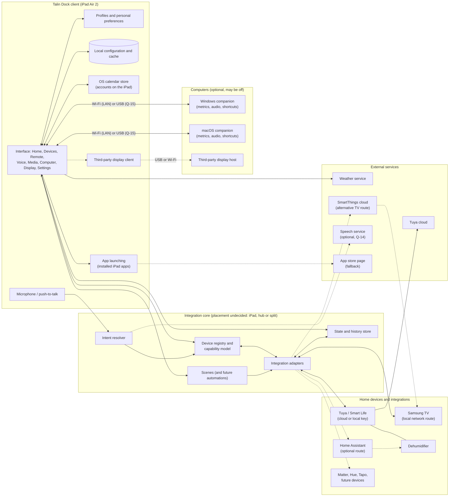

# Talin Dock: System Requirements (platform-independent)

Version 1.0 · 4 November 2026 · Companion to `PRODUCT_SPECIFICATION.md`.

This document states the capabilities an implementation must provide. It does not choose a platform, language, framework or hub. Where a requirement depends on an open question, the question is referenced (see `OPEN_QUESTIONS.md`).

Requirement IDs use the form **SR-area-number**. "Must" marks MVP-level needs and "should" marks later phases, following `PRODUCT_SPECIFICATION.md` §15.

---

## 1. Target environment constraints

- **SR-ENV-1**: The primary display device is an iPad Air 2: iPadOS 15 maximum, 2 GB RAM, 2048 × 1536 pixels (1024 × 768 points). The client experience must run acceptably within these limits.
- **SR-ENV-2**: The client must support landscape (primary) and portrait orientation.
- **SR-ENV-3**: Home functions must not require any computer to be switched on.
- **SR-ENV-4**: Home functions using local routes must not require internet access.
- **SR-ENV-5**: No requirement may assume that all services run on the iPad (Q-1).

## 2. Touch interface

- **SR-UI-1**: Touch-first interaction with a minimum target size of 44 × 44 pt.
- **SR-UI-2**: Press-and-hold input for push-to-talk, with a distinct release event.
- **SR-UI-3**: Continuous drag input for sliders (volume, brightness, target humidity, media apps).
- **SR-UI-4**: Visual feedback within 100 ms of a touch, independent of network round-trips. Optimistic state with later confirmation or rollback is required where commands are asynchronous.
- **SR-UI-5**: Text entry for names, event titles and locations.
- **SR-UI-6** (should): Accessibility labels for all icon-only controls. The prototype markup already provides them.

## 3. Full-screen, appliance-style operation

- **SR-APP-1**: Run full screen without browser or system chrome during normal use.
- **SR-APP-2**: Keep the display on while docked, with a policy for dimming or ambient mode (Q-23).
- **SR-APP-3**: Recover to a usable state after a crash or device restart, ideally without manual intervention (Q-2).
- **SR-APP-4**: Allow leaving to launch other apps and returning reliably (Q-25). This may conflict with kiosk-style locking; the tension must be resolved.
- **SR-APP-5** (should): An inactivity timer for idle auto-return to the Household profile and for Ambient mode.

## 4. Local data storage

Must persist across restarts:

| Data | Scope |
|---|---|
| Profiles and personal preferences: theme, clock format, calendar visibility, favourites, voice options, voice history | Per profile |
| Rooms; per-room widget layouts (type, size, order) | Household |
| Device registry: type, name, room, route, capabilities, access, "show on Home", route-specific identifiers | Household |
| App shortcut lists (media, TV) and recent-launch history | Household; history per device |
| Computer pairings and link preferences (preferred link, auto-reconnect) | Household |
| Sensor history for trends: at least 12 hours of humidity | Household (Q-28) |
| Last known values for cached display: weather, device states, calendar snapshot | Device |

- **SR-DATA-1**: Writes must be durable. A configuration change must survive an immediate power loss.
- **SR-DATA-2** (should): Export and backup of configuration, and restore to a replacement device (Q-11).

## 5. Secure credential storage

- **SR-SEC-1**: Store integration credentials (cloud tokens, local keys, TV pairing tokens, companion pairing keys) in a protected store, separate from general configuration (Q-30).
- **SR-SEC-2**: Never display credentials in the interface after entry.
- **SR-SEC-3**: Support revocation: Unpair, Disconnect, Remove device.
- **SR-SEC-4**: Protect companion traffic on the local network against eavesdropping and spoofing (Q-18).

## 6. Authentication and authorisation

- **SR-AUTH-1**: No authentication is required to use the Household profile or to switch profiles (current design).
- **SR-AUTH-2**: The data model must support an optional future protection layer for personal profiles or privacy settings without redesign (Q-7).
- **SR-AUTH-3**: If "Who can use it" becomes a restriction, every command path must check it: widgets, Devices, Remote, scenes, voice (Q-8).
- **SR-AUTH-4**: Calendar privacy (full / busy / hidden) must be enforced in every view and widget, and in voice answers if voice reads calendars.

## 7. Network communication

- **SR-NET-1**: Local network communication with devices and hubs (discovery, control, state). This requires local network permission on the client device.
- **SR-NET-2**: Internet communication for cloud routes (Tuya cloud, SmartThings), weather and, if chosen, voice processing.
- **SR-NET-3**: Each integration exposes reachability separately, so one failing route does not mark unrelated devices unavailable.
- **SR-NET-4**: Time-outs and retry with back-off on every command and poll; user-visible failure within a bounded time (proposed: 5 s for commands).
- **SR-NET-5**: Detection of client connectivity loss (the iPad's own Wi-Fi), distinct from device loss.

## 8. Background services

- **SR-BG-1**: State updates for devices and sensors while the dashboard is visible.
- **SR-BG-2** (should): Continuous collection of sensor history and alert conditions even when the dashboard is not frontmost or the client is off. This strongly suggests a component that runs independently of the client (Q-1, Q-28, Q-32).
- **SR-BG-3** (should): Scene execution, and in future automations, that do not depend on the client being frontmost.

## 9. Device discovery and integration adapters

- **SR-DEV-1**: An adapter per integration route, each providing:
  - Supported device types.
  - Discovery (network scan, account import, bridge or server import, pairing code), as the route allows.
  - Pairing and authorisation.
  - **Capability reporting per device**, which is required to bound user-selected capabilities (Q-4).
  - State reading, by push or polling.
  - Command execution with acknowledgement.
  - Reachability.
- **SR-DEV-2**: A normalised capability and state model consumed by the interface. Types covered by the design: TV, dehumidifier, light, smart plug, sensor, air conditioner, camera.
- **SR-DEV-3**: Instance-based devices. Multiple TVs or dehumidifiers must be independent (Q-37).
- **SR-DEV-4**: Discovery must exclude devices already registered.
- **MVP routes**:
  - **Samsung TV**: local route and/or SmartThings (Q-5).
  - **Tuya dehumidifier**: cloud and/or local (Q-6).
- **Later routes**: Home Assistant, Matter, Philips Hue, TP-Link Tapo.

## 10. Real-time state updates

- **SR-RT-1**: Reflect device changes made outside Talin Dock (manufacturer app, physical remote) on all surfaces. Proposed target: within 5 s where the route pushes changes; within the poll interval otherwise.
- **SR-RT-2**: Each value carries a timestamp so stale data can be identified and shown (Q-31).
- **SR-RT-3**: A single source of truth per device state, shared by tiles, widgets, sheets, Remote, Ambient, scenes and voice.

## 11. API integrations (external services)

| Need | Requirement |
|---|---|
| Weather | Current conditions plus a 5-day forecast for a configured location; cached; age shown (Q-10) |
| Cloud device APIs | Per route; must handle rate limits and token expiry |
| Speech processing (if external) | Short audio in, text or intent out; bounded latency; privacy terms acceptable (Q-14) |

## 12. Calendar access

- **SR-CAL-1**: Read events from the calendars available on the client device through the operating system's calendar store, including accounts configured on the device. No provider is assumed.
- **SR-CAL-2**: Write new events to a chosen writable calendar, so that they sync through that calendar's account.
- **SR-CAL-3**: Map each calendar to an owner: a household member, or shared.
- **SR-CAL-4**: Handle permission not granted, granted, and revoked.
- **SR-CAL-5**: React to calendar-store changes without restart.
- **SR-CAL-6** (should): Support all-day events and multi-week ranges; recurrence and multi-day events must at least display correctly (Q-27).

## 13. Application launching

- **SR-LAUNCH-1**: Open installed apps on the client device through their official app links or URL schemes, optionally with deep-link targets.
- **SR-LAUNCH-2**: Determine app availability where the platform permits, and otherwise detect a failed launch. Fall back to the app's store page.
- **SR-LAUNCH-3**: Launch apps **on the TV** through the TV route, as a distinct capability from launching on the client (Q-19).
- **SR-LAUNCH-4**: Verify each target app's support for iPadOS 15 (Q-13).

## 14. Microphone and voice

- **SR-VOICE-1**: Microphone capture only while push-to-talk is held. Permission handling covers not granted, granted and revoked.
- **SR-VOICE-2**: Speech-to-text or intent recognition, with the location undecided (Q-14). Languages to consider: English (Ireland, UK) and Portuguese (Brazil).
- **SR-VOICE-3**: An intent resolver against the device registry, capability and reachability.
- **SR-VOICE-4**: Responses as text, and optionally speech.
- **SR-VOICE-5**: Defined responses for: not understood, ambiguous, device absent, capability off, unavailable, blocked by state.
- **SR-VOICE-6**: No wake word or always-on listening in the current design.

## 15. Local networking with computers (Computer mode)

- **SR-PC-1**: A companion service on each supported computer (Windows, macOS) providing:
  - **Metrics**: CPU, memory, GPU.
  - **Audio**: the session inventory, master and per-app volume and mute, output devices.
  - **Media control** and **system commands**: lock, sleep, screenshot, opening Task Manager or Activity Monitor, Show Desktop or Mission Control, mic mute.
- **SR-PC-2**: Transport over Wi-Fi (LAN). USB transport is required by the design but its feasibility is unverified (Q-15).
- **SR-PC-3**: Link selection: preferred link, automatic fallback, reconnection when the computer returns. Heartbeat-based status and quality measurement.
- **SR-PC-4**: Pairing with user confirmation on both sides; revocable (Q-18).
- **SR-PC-5**: Support for more than one computer per platform, if Q-17 decides so.
- **SR-PC-6**: Per-app volume on macOS may need an additional audio component (Q-16).

## 16. External display support

- **SR-DISP-1**: Talin Dock does not implement display streaming. It must hand off to a third-party display application on the client and inform the user of the requirements.
- **SR-DISP-2** (should): Detect host availability if the chosen software makes that possible (Q-12).
- **SR-DISP-3**: The chosen software must support iPadOS 15 on the client and the relevant Windows and macOS versions on the hosts. Apple Sidecar is not available on the iPad Air 2.

## 17. Performance on older hardware

Proposed targets, for the reviewer to confirm:

- **SR-PERF-1**: Cold start to a usable Home dashboard in at most 3 s, with cached data shown first.
- **SR-PERF-2**: Interface interactions (room change, sheet open) in at most 300 ms on the iPad Air 2.
- **SR-PERF-3**: Steady-state memory well within the iPad Air 2's limits, with headroom for the operating system and for launching other apps.
- **SR-PERF-4**: Animations limited to subtle transitions; the design already avoids heavy effects. Blur and translucency used sparingly.
- **SR-PERF-5**: Polling intervals adaptive to visibility: slower when a screen is not shown.

## 18. Observability and support

- **SR-OPS-1** (should): A local diagnostic view or log per integration (last success, last error), to support "Not responding" investigation.
- **SR-OPS-2**: No personal calendar content or audio in logs.

---

## 19. Logical architecture (technology-neutral)

The diagram shows logical responsibilities only. "Integration core" may run on the iPad, on an always-on home hub, or split between them; that placement is Q-1. Dashed lines are optional or later-phase connections.

**Reading notes**

- The Computers group connects directly to the client in the diagram because the prototype presents computer links as the iPad's own USB and Wi-Fi connections. Whether a hub could also mediate them is open.
- The display path (client display app to display host) is entirely third-party. Talin Dock only launches the client app.
- Home Assistant is drawn as one optional route. If Q-1 makes it the backbone, most adapter arrows would route through it instead.
